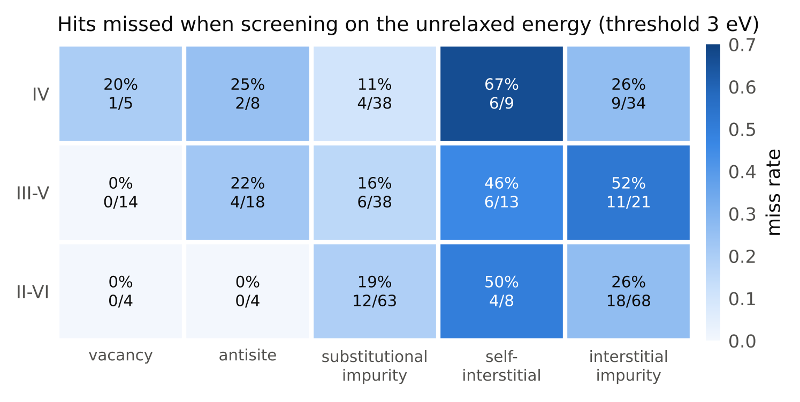
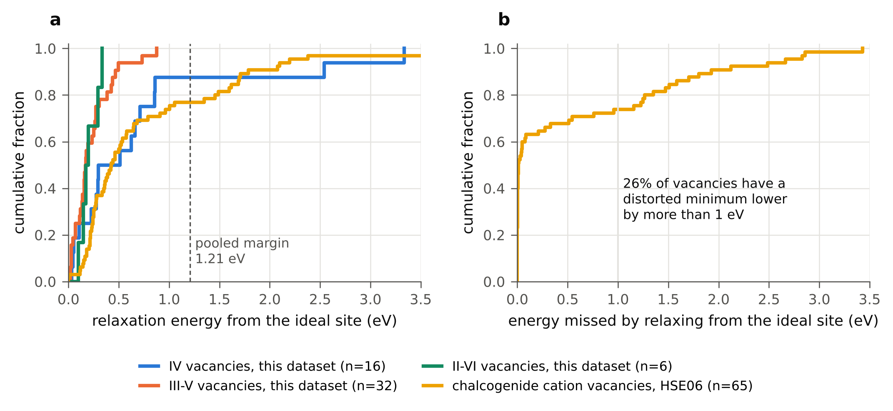

# relaxfree-defect-audit

[](https://doi.org/10.5281/zenodo.24356116)

**When can defect relaxation be skipped?** A cross-host audit of relaxation-free
point-defect prescreening in zinc blende semiconductors.

High-throughput defect workflows spend most of their budget relaxing supercells.
Prescreening models try to avoid that step, but they are usually judged by a
single global error. This repository asks a decision-level question instead:
if a candidate is discarded *before* relaxation, how often was it actually a
low-energy defect, and how does that depend on the host family and the defect
type?

The answer is measured on 813 neutral point defects in 32 group IV, III-V and
II-VI hosts, for which the public DFT relaxation trajectories of Rahman et al.
give both the ideal-site (unrelaxed) and the relaxed formation energy.

A note on the data: the upstream calculations started many relaxations from
randomly displaced geometries (generated with `atomsk -disturb`, see
`Codes/Shell_script_to_apply_distortion` in the upstream repository). For those
trajectories the first frame is not the ideal-site defect, so its energy is not
the single point a screening workflow would compute. Every first frame is
therefore checked against the ideal zinc blende sites, and only the 813
trajectories that start exactly on them (largest displacement below 0.02 Å)
enter the main analysis. The other 736, mostly impurities in II-VI hosts and all
defects in CdS and CdSe, are kept in the processed table for sensitivity checks.



## Main results

Screening task: keep every defect whose relaxed formation energy is below
3 eV (345 of 813 defects).

1. **Relaxation is not a small correction.** The median relaxation energy is
   0.55 eV, 35 % of the defects relax by more than 1 eV, and the 99th
   percentile is 7.3 eV. Vacancies in III-V and II-VI hosts relax by about
   0.2 eV; interstitials in all three families by 0.6-1.2 eV.
2. **Screening on the unrelaxed energy loses a quarter of the hits** (83 of
   345). No vacancy hit is lost in III-V or II-VI hosts, while 46-67 % of the
   self-interstitial hits and 52 % of the III-V interstitial-impurity hits are.
3. **A calibrated margin fixes the average, not the cells.** A single
   split-conformal margin brings the miss rate to the 10 % target and still
   avoids 56 % of the recorded relaxation steps. Under that same margin,
   III-V interstitial impurities are missed at 28 % and group IV antisites at
   19 %.
4. **Cell-wise calibration is honest but data-hungry.** Calibrating each
   family x class cell separately keeps every calibrated cell at or below the
   target (at most 8 % missed), but half of the candidates sit in cells with
   too few known hits to calibrate at all (74 % when the host is new). Those
   cells must be relaxed.
5. **What transfers.** Margins calibrated on other hosts carry over to an
   unseen host for all three proxies (8-9 % missed at a 10 % target), and the
   two proxies built on a single-point calculation also hold when a whole
   family is new (9-10 %). The identity-only model does not: it misses 13.5 %
   of the hits on a new family overall and 24 % in group IV.
6. **External check: the vacancy result does not travel.** In an independent
   HSE06 dataset of 65 cation vacancies in 42 lower-symmetry chalcogenide hosts
   (Mosquera-Lois et al., 2024), relaxation from the ideal site lowers the
   energy by a median of 0.43 eV and by more than 1 eV for 26 % of them, against
   0.21 eV and 4 % for the zinc blende vacancies here (Mann-Whitney p < 1e-4).
   23 % of them relax by more than the pooled margin calibrated on this
   dataset, which bounds the miss rate from above, and 26 % have a distorted
   minimum more than 1 eV below the ideal-site relaxation. Whether relaxation
   can be skipped for a defect class has to be established per chemistry.



Calibrated screening at tau = 3 eV, alpha = 0.1 with one pooled margin. Entries
are hits missed / candidates discarded / relaxation steps avoided / candidates
in uncalibrated groups.

<!-- screening-table:start -->
| proxy | seen hosts | unseen host | unseen family |
|---|---|---|---|
| unrelaxed energy | 10.0% / 51% / 56% / 0% | 8.3% / 45% / 50% / 0% | 9.2% / 48% / 53% / 0% |
| identity-only model | 9.7% / 48% / 51% / 0% | 9.2% / 42% / 45% / 0% | 13.5% / 38% / 42% / 0% |
| unrelaxed + learned relaxation energy | 10.1% / 60% / 60% / 0% | 8.1% / 55% / 54% / 0% | 9.6% / 56% / 56% / 0% |
<!-- screening-table:end -->

All tables are generated from the result files by `experiments/07_tables.py`
and collected in [`results/tables.md`](results/tables.md); all figures are
drawn by `experiments/06_figures.py`.

## Robustness checks

`experiments/10_robustness.py` and the bootstrap in `experiments/04_conformal_screening.py` add the following
(tables 18 onwards in `results/tables.md`):

- **Intervals that respect repeated use of defects.** Cell-level miss rates are resampled over defects. Under a
  pooled margin only III-V interstitial impurities exceed the target with a 95% interval above it, and they do so
  for every proxy and regime.
- **Merged cells.** Cells with too few calibration hits are merged within their defect class and then into a
  residual block (`relaxfree.conformal.merged_blocks`). Coverage rises from 50% to 99% of the candidates; the
  guarantee then holds per block, not per cell.
- **Partial relaxation.** The energy after 1, 2, 3 or 5 ionic steps as the proxy (`figures/fig8_partial_relaxation`).
  A single point with a margin is as economical as a short relaxation at a 10% target; a short relaxation wins
  at 5%.
- **Fixed offset.** Screening on the unrelaxed energy minus a fixed 1 eV offset, a common rule of thumb, misses
  between 5% and 14% of the hits depending on the threshold; a calibrated margin stays near its target.
- **Unseen impurity species**, **threshold scan** (1 to 6 eV), **B-rich chemical potentials** for native defects,
  **regression model**, **cost of the single point**, **size of the calibration sample**, and a **host-level**
  version of the external comparison.

## Proxies

| name | needs | what it is |
|---|---|---|
| `unrelaxed` | one SCF per candidate | formation energy of the defect on its ideal site |
| `identity` | nothing | gradient-boosted regression on host, site and species descriptors |
| `hybrid` | one SCF per candidate | unrelaxed energy minus a learned relaxation energy |

A candidate is kept when `proxy - margin <= tau`. The margin is the split-conformal
quantile of the proxy values of calibration hits, which bounds the expected
miss rate by `alpha` for hits exchangeable with the calibration hits. Margins
are computed once for all defects (pooled), per defect class, or per
family x class cell; a group with fewer than `ceil(1/alpha) - 1` calibration
hits gets no margin and all of its candidates are kept (abstention).

Three regimes are evaluated: random splits (hosts seen), leave-one-host-out,
and leave-one-family-out. In the last two, calibration hosts are disjoint from
both the training and the test hosts.

## Reproducing

```bash
pip install -e ".[dev]"
bash scripts/fetch_data.sh     # optional: the processed tables are already in data/processed
bash run_all.sh                # about 30 minutes
pytest
```

`run_all.sh` rebuilds `data/processed/` only if `data/raw/labels` exists, then
writes every table to `results/` and every figure to `figures/`.

| script | output |
|---|---|
| `experiments/01_build_dataset.py` | processed tables and QC counts |
| `experiments/02_relaxation_audit.py` | relaxation energies and unrelaxed-screen miss rates per cell |
| `experiments/03_proxy_accuracy.py` | MAE of each proxy and model under the three regimes |
| `experiments/04_conformal_screening.py` | calibrated screening: miss rate, discard fraction, steps avoided |
| `experiments/05_secondary_analyses.py` | drivers of the relaxation energy; charged states |
| `experiments/06_figures.py` | figures |
| `experiments/07_tables.py` | `results/tables.md` and the table in this README |
| `experiments/08_alloy_subset_check.py` | start-geometry check of the excluded alloy subset |
| `experiments/09_external_vacancies.py` | external check on chalcogenide cation vacancies |
| `scripts/extract_external_vacancies.py` | per-step energies from the 20.6 GB external archive |

## Using the calibration on your own proxy

```python
import numpy as np
from relaxfree.conformal import recall_margin, keep_mask

# proxy_cal, y_cal: proxy values and relaxed energies of defects you have already relaxed
margin = recall_margin(proxy_cal, y_cal, tau=3.0, alpha=0.1)
keep = keep_mask(proxy_new, margin, tau=3.0)   # relax only these
```

`grouped_recall_margin` does the same per group and returns an infinite margin
for groups that cannot be calibrated.

## Scope and caveats

- The screening analysis rests on one dataset and one structure type
  (semi-local DFT, 64-atom zinc blende supercells, as published upstream). The
  external dataset has no host or chemical-potential references, so it tests
  relaxation energies and margins but not screening decisions directly.
- "Relaxed" means the last recorded ionic step of the upstream trajectory. The
  search for symmetry-broken ground states (e.g. ShakeNBreak) was not part of
  those calculations, so true relaxation energies can only be larger.
- Trajectories that start from displaced geometries (736), lack a first frame
  (79, mostly above 15 eV) or have a single frame (86) are excluded; see
  `data/README.md`. Counting any of them back in, or taking the lowest frame as
  the relaxed energy, moves the miss rate of the unrelaxed screen by at most
  6 points (`results/naive_unrelaxed_sensitivity.csv`).
- The CdSe(x)Te(1-x) alloy subset of the upstream data cannot serve as an
  external test: none of its first frames is an ideal-site defect, most of its
  trajectories start close to their end point, and one composition starts in
  an unrelaxed host (`experiments/08_alloy_subset_check.py`).
- Charged-state trajectories start from the neutral relaxed geometry, so they
  answer a different question and are analysed separately.
- "Relaxation steps avoided" counts recorded ionic steps, not CPU hours.

## Citation

If you use this code or the derived tables, please cite

> Y. Shan, *relaxfree-defect-audit: when can defect relaxation be skipped?*
> Zenodo (2026), <https://doi.org/10.5281/zenodo.24356116>

together with the original datasets listed below.

## Data and licence

The external vacancy energies are derived from the dataset of Mosquera-Lois,
Kavanagh, Ganose and Walsh (npj Comput. Mater. 10, 121, 2024;
<https://doi.org/10.5281/zenodo.10579527>); cite it if you use that table.

Code is released under the MIT licence. The formation energies are derived from
the dataset of Rahman et al. (APL Mach. Learn. 2, 016122, 2024;
<https://github.com/msehabibur/defect_GNN_gen_1>) and Mannodi-Kanakkithodi et
al. (Patterns 3, 100450, 2022); cite them if you use the tables. Elemental
properties are from the Magpie tables distributed with matminer.
